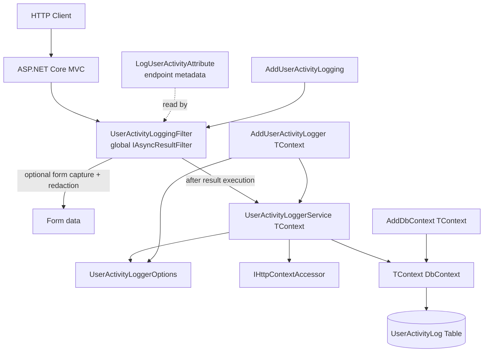
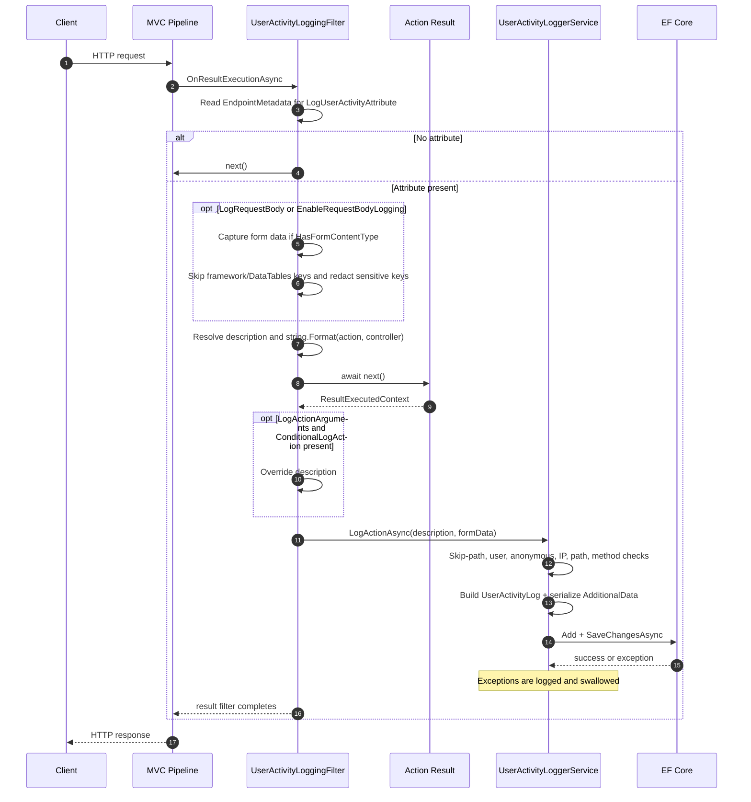

# Architecture overview

This document explains how `UserActivityLogger` 1.0.10 works internally, what it stores, and the constraints you should account for when designing an audit feature.

---

## 1. High-level design

`UserActivityLogger` is built from four cooperating pieces:

1. **Metadata** — `LogUserActivityAttribute` marks an MVC endpoint for logging.
2. **Interception** — `UserActivityLoggingFilter` runs globally as an MVC result filter.
3. **Capture and mapping** — `UserActivityLoggerService<TContext>` reads the current HTTP context, resolves configuration, and builds a `UserActivityLog`.
4. **Persistence** — EF Core saves the entity through the application's registered `DbContext`.



---

## 2. Request pipeline

### Registration

Two registrations are required:

```csharp
builder.Services.AddUserActivityLogger<AppDbContext>(options =>
{
    // Global options.
});

builder.Services.AddControllersWithViews(options =>
{
    options.AddUserActivityLogging();
});
```

`AddUserActivityLogger<TContext>()` registers:

| Service | Lifetime | Role |
|---|---|---|
| `UserActivityLoggerOptions` | Singleton | Global configuration instance. |
| `IHttpContextAccessor` | Singleton | Access to the current request. |
| `IUserActivityLogger` | Scoped | Maps the request to `UserActivityLog` and saves it. |
| `UserActivityLoggingFilter` | Scoped | Global MVC filter instance. |

`AddUserActivityLogging()` adds the filter as a global service filter. The filter is resolved for each MVC request, but it only writes a record when the endpoint carries `[LogUserActivity]`.

### Filter execution

`UserActivityLoggingFilter` implements `IAsyncResultFilter`. Its lifecycle is:

```text
MVC selects action
    ↓
Global filter resolves
    ↓
OnResultExecutionAsync
    ↓
Find LogUserActivityAttribute in EndpointMetadata
    ↓
No attribute? → next() → no log
    ↓
Attribute found?
    ↓
Optional form capture (filter, before result)
    ↓
Resolve/format action description
    ↓
await next() executes the action result
    ↓
Optional conditional description override
    ↓
IUserActivityLogger.LogActionAsync(...)
    ↓
UserActivityLoggerService<TContext> builds and saves the entity
```

A sequence view:



### Why it is a result filter

Because the filter runs around **result execution**, the log is written after the action has produced and executed its result. This has important consequences:

- Normal results such as `Ok()`, `View()`, `NotFound()`, and `BadRequest()` are logged.
- An exception thrown by the action or result generally bypasses the log call.
- Authorization/resource short-circuits may bypass result filters entirely.
- The response status code is available when the service builds the record.

The implementation has no `try/finally`, so if `next()` throws, the logging call is skipped.

---

## 3. Filter details

### Attribute discovery

```csharp
var attribute = context.ActionDescriptor.EndpointMetadata
    .OfType<LogUserActivityAttribute>()
    .FirstOrDefault();

if (attribute == null)
{
    await next();
    return;
}
```

- The attribute is read from endpoint metadata, so it works on controller actions.
- Only the first matching attribute is used.
- If both a controller-level and action-level attribute are present, the selected one may be ambiguous. Prefer one action-level attribute.

### Form capture

Form capture occurs before `next()` when either condition is true:

- `attribute.LogRequestBody` is `true`.
- The global `EnableRequestBodyLogging` option is `true`.

It only runs when `Request.HasFormContentType` is true. The filter:

1. Iterates `Request.Form.Keys`.
2. Skips keys starting with `__`.
3. Skips hard-coded DataTables keys (`columns[...]`, `order[...]`, `search[...]`, `draw`, `start`, `length`).
4. Replaces values whose key contains a redacted term.
5. Normalizes `"true"`/`"false"` to `"True"`/`"False"`.
6. Stores the result in a dictionary, later serialized to JSON.

If the dictionary is empty, `AdditionalData` remains null.

Form parsing is synchronous. Any exception is logged as `Failed to capture form data` and body capture returns null; the request continues.

### Description resolution

```csharp
var controllerName = actionDescriptor.RouteValues["controller"] ?? string.Empty;
var actionName = actionDescriptor.RouteValues["action"] ?? string.Empty;

var logMessage = attribute.ActionDescription
    ?? actionDescriptor.DisplayName
    ?? "Unknown Action";

logMessage = string.Format(logMessage, actionName, controllerName);
```

- The description is always treated as a format string.
- `{0}` receives the action name.
- `{1}` receives the controller name.
- Literal braces or unsupported placeholders can throw `FormatException` before the action executes.
- The result is not truncated to the 500-character entity limit.

### Conditional override

After the result executes:

```csharp
if (attribute.LogActionArguments
    && executedContext.HttpContext.Items.ContainsKey("ConditionalLogAction"))
{
    var conditionalAction =
        executedContext.HttpContext.Items["ConditionalLogAction"]?.ToString();

    if (!string.IsNullOrEmpty(conditionalAction))
    {
        logMessage = conditionalAction;
    }
}
```

The key is a magic string. The override is stored as-is and is not formatted.

### Logging call

The filter calls:

```csharp
await _userLogger.LogActionAsync(logMessage, requestBody);
```

There is no try/catch around this call. The service handles persistence exceptions internally, but other failures (for example, a custom IP resolver that throws, or a null `SkipPaths` option) can propagate after the action result has executed.

---

## 4. Service details

### `LogActionAsync`

`LogActionAsync` requires a current `HttpContext`:

```text
Get HttpContext via IHttpContextAccessor
    ↓
No context? → log warning and return
    ↓
ShouldSkipPath? → return
    ↓
Resolve user ID from configured claim
    ↓
No user ID and LogAnonymousUsers = false? → return
    ↓
Build UserActivityLog
    ↓
Serialize AdditionalData as JSON
    ↓
LogAsync(entity)
```

The entity is populated with:

- `UserId` — from `UserIdClaimType`.
- `Event` — the resolved description.
- `Path` — request path plus decoded query string.
- `Method` — HTTP method.
- `IPAddress` — custom resolver or remote IP.
- `AdditionalData` — form dictionary or caller object.
- `ResponseStatusCode` — current response status.
- `DateEvent` — entity default (`DateTime.Now`).

### `LogAsync`

```csharp
_context.Set<UserActivityLog>().Add(log);
await _context.SaveChangesAsync();
```

The implementation catches all exceptions, writes `Failed to save user activity log` to `ILogger`, and returns. There is no success/failure result, no retry, and no cancellation token.

`LogAsync` is the correct choice for background work because it does not depend on `HttpContext`. It still uses the scoped `DbContext` when resolved from a request scope.

---

## 5. Data model

`UserActivityLog` is a public EF Core entity.

| Property | CLR type | Constraints | Notes |
|---|---|---|---|
| `Id` | `int` | Key, identity by convention | Primary key. |
| `ResponseStatusCode` | `int` | Required | `0` for manually constructed records unless set. |
| `Event` | `string` | Required, max 500 | Action description. |
| `IPAddress` | `string?` | Max 50 | IPv6 fits in 45 characters; `"Unknown"` is used when unavailable. |
| `Path` | `string?` | Max 2000 | Includes the decoded query string in current behavior. |
| `Method` | `string?` | Max 10 | HTTP method or custom value such as `BACKGROUND`. |
| `AdditionalData` | `string?` | Unlimited | Serialized JSON. |
| `DateEvent` | `DateTime` | Required | Defaults to `DateTime.Now` (local time). |
| `UserId` | `string?` | Max 450 | No foreign key or navigation by default. |

### Table configuration

```csharp
modelBuilder.Entity<UserActivityLog>(entity =>
{
    entity.HasKey(entity => entity.Id);

    entity.Property(entity => entity.Event)
        .IsRequired()
        .HasMaxLength(500);

    entity.Property(entity => entity.UserId).HasMaxLength(450);
    entity.Property(entity => entity.IPAddress).HasMaxLength(50);
    entity.Property(entity => entity.Path).HasMaxLength(2000);
    entity.Property(entity => entity.Method).HasMaxLength(10);

    entity.HasIndex(entity => entity.UserId);
    entity.HasIndex(entity => entity.DateEvent);
    entity.HasIndex(entity => entity.Event);
    entity.HasIndex(entity => new { entity.UserId, entity.DateEvent });
});
```

### Indexes

| Index | Purpose |
|---|---|
| `UserId` | Per-user lookups. |
| `DateEvent` | Time-range queries and recent activity. |
| `Event` | Equality/prefix event queries. It does not accelerate `Contains` searches. |
| `(UserId, DateEvent)` | A user's chronological activity. |

The standalone `UserId` index is largely redundant with the composite `(UserId, DateEvent)` index, whose leading column is `UserId`. Review index cost against your actual query patterns.

### Table naming

The model configuration does not call `ToTable`. EF Core determines the table name as follows:

- If a `DbSet<UserActivityLog>` property exists, its property name is used.
- Otherwise, the entity type name (`UserActivityLog`) is used.

Therefore, adding `DbSet<UserActivityLog> UserActivityLogs` can change the conventional table name to `UserActivityLogs`. Pin the name if it must remain stable:

```csharp
builder.Entity<UserActivityLog>().ToTable("UserActivityLog");
```

### No user relationship

The entity has only a `UserId` string. There is no configured foreign key, navigation property, cascade behavior, or referential integrity. The commented-out `User` property in the entity is not active. If you need a relationship, configure it in your own model and add a navigation property.

---

## 6. Configuration model

`UserActivityLoggerOptions` is created once in `AddUserActivityLogger` and registered as a singleton:

```csharp
var options = new UserActivityLoggerOptions();
configure?.Invoke(options);
services.AddSingleton(options);
```

Consequences:

- Options are fixed after startup.
- There is no `IOptionsMonitor` reload support.
- The instance is mutable; treat it as immutable after configuration.
- There is no built-in validation for null arrays, empty claim types, or custom resolver output.

Global options are described in [Security and Configuration](security-and-configuration.md).

---

## 7. Limitations

The following constraints are important when evaluating the library for production use.

### 7.1 Result-filter coverage

The filter logs after result execution. It is not a complete request audit:

- exceptions thrown by the action/result are generally not logged,
- authorization/resource short-circuits may not reach the result filter,
- minimal API endpoints do not use this MVC filter,
- static files and non-MVC traffic are outside its scope.

If failed or blocked operations must be audited, add explicit exception/middleware logging or a different filter strategy.

### 7.2 Synchronous request-path persistence

The audit insert is performed inline with the request:

```csharp
await _context.SaveChangesAsync();
```

There is no queue, outbox, batching, retry, or background worker. Slow database writes increase request latency, and database outages result in lost audit records.

### 7.3 Persistent failures are swallowed

`LogAsync` catches every exception and writes it to `ILogger`. The HTTP request still succeeds. Without monitoring, audit gaps can go unnoticed.

### 7.4 DbContext isolation and unit of work

By default (`IsolatePersistence = true`), `UserActivityLoggerService<TContext>` writes audit records through an isolated `DbContext` instance (via `IDbContextFactory<TContext>` or an isolated service scope), ensuring that:

- pending business changes staged in the request's scoped `DbContext` are **never** committed by an audit write,
- audit writes are isolated from the host application's unit of work and transactions,
- an uncommitted business entity remains untouched in the change tracker if an audit write succeeds or fails.

If `IsolatePersistence` is set to `false`, the service operates in legacy shared unit of work mode, where:

- all pending tracked changes in the scoped context are saved along with the audit row,
- a failed save detaches the audit entity from the change tracker to prevent corrupting subsequent operations.

For complete database isolation, `AddDedicatedUserActivityLogger` allows storing audit records in a dedicated database or schema using `AuditDbContext`.

### 7.5 Form-only body capture

Only form-encoded requests are captured. JSON, XML, plain text, and other request bodies are not stored. Request body logging is opt-in and can add parsing/memory overhead for large forms.

### 7.6 Redaction scope

Redaction applies to form keys only. It does not redact:

- query strings,
- `AdditionalData`,
- values whose keys do not match the configured terms,
- headers or other request data.

### 7.7 No audit integrity guarantees

The audit table is a normal mutable table. The application can update or delete rows, and there is no hash chain, signature, append-only enforcement, or WORM storage. Use database permissions, backups, and retention controls appropriate to your risk model.

### 7.8 Local timestamps

`DateEvent` defaults to `DateTime.Now`. Multi-server deployments and daylight-saving transitions can make ordering ambiguous. For UTC records, set `DateEvent` explicitly when using `LogAsync`; filter-created records use local time.

### 7.9 No built-in retention or archival

There is no cleanup job, partitioning, or archival support. High-volume logging requires an application-level retention strategy.

---

## 8. Design decisions

This section records the architectural rationale and trade-offs behind foundational library decisions:

### Multi-targeting .NET 8, 9, and 10

- Decision: `UserActivityLogger.csproj` multi-targets `net8.0`, `net9.0`, and `net10.0` with conditional package references for `Microsoft.EntityFrameworkCore` (8.0 on net8.0, 9.0 on net9.0, 10.0 on net10.0).
- Rationale: .NET 8 is an enterprise Long Term Support (LTS) release, while .NET 9 and 10 represent Standard Term Support and subsequent runtimes. Multi-targeting prevents assembly resolution warnings and dependency downgrades for consumers on each framework.
- Alternatives considered: Targeting only .NET 9 was rejected because it excludes .NET 8 LTS applications. Targeting .NET Standard 2.0 was rejected because modern ASP.NET Core MVC and EF Core rely on modern .NET runtime shared frameworks.

### MVC result filter architecture

- Decision: Request interception is implemented via `UserActivityLoggingFilter` implementing `IAsyncResultFilter` rather than middleware or an action filter.
- Rationale: A result filter runs around action result execution (view rendering or response serialization), allowing it to record the final HTTP status code (`Response.StatusCode`) produced by the action and inspect `HttpContext.Items` for runtime overrides.
- Trade-offs: Unhandled exceptions during action execution bypass result execution and are not logged by the filter. Endpoints outside MVC (such as Minimal APIs) do not execute MVC filters (tracked in [#5](https://github.com/Asma-Elhadiedy/UserActivityLogger/issues/5)).
- Alternatives considered: Middleware was rejected because it lacks direct access to MVC action descriptors and route values without custom endpoint routing resolution. Action filters (`IAsyncActionFilter`) were rejected because they complete before the action result executes, leaving the final status code unavailable.

### DbContext isolation model

- Decision: By default (`IsolatePersistence = true`), audit persistence runs in an isolated `DbContext` instance resolved via `IDbContextFactory<TContext>` or an independent `IServiceScope`.
- Rationale: In ASP.NET Core, sharing the request's scoped `DbContext` risks unintentionally committing uncommitted business entities or corrupting the unit of work when an audit write occurs. Isolating the context guarantees zero side effects on the application's transaction state while still reusing the database configuration.
- Alternatives considered: Forcing a mandatory separate database connection was rejected because many applications prefer storing audit logs within the same database. Retaining shared context mode as a configurable option (`IsolatePersistence = false`) maintains compatibility for scenarios requiring atomic commits. Dedicated databases are supported via `AddDedicatedUserActivityLogger`.

---

## 9. Public API summary

| Type | Namespace | Role |
|---|---|---|
| `LogUserActivityAttribute` | `UserActivityLogger.Attributes` | Declarative opt-in and per-action options. |
| `UserActivityLoggerOptions` | `UserActivityLogger.Options` | Global configuration. |
| `IUserActivityLogger` | `UserActivityLogger.Services` | Logging contract. |
| `UserActivityLoggerService<TContext>` | `UserActivityLogger.Services` | EF Core-backed implementation. |
| `AuditDbContext` | `UserActivityLogger.Entities` | Dedicated audit DbContext for separate databases or schemas. |
| `UserActivityLog` | `UserActivityLogger.Entities` | Persisted audit entity. |
| `AddUserActivityLogger<TContext>()` | `UserActivityLogger.Extensions` | DI registration with configurable isolation. |
| `AddIsolatedUserActivityLogger<TContext>()` | `UserActivityLogger.Extensions` | DI registration explicitly enabling isolated persistence. |
| `AddDedicatedUserActivityLogger()` | `UserActivityLogger.Extensions` | DI registration using dedicated `AuditDbContext`. |
| `AddUserActivityLogging()` | `UserActivityLogger.Extensions` | MVC filter registration. |
| `ConfigureUserActivityLogger()` | `UserActivityLogger.Extensions` | EF model configuration. |
| `ConstPredefinedLogMessage` | `UserActivityLogger.Constants` | Predefined event templates. |

---

## Related documentation

- [Getting started](getting-started.md)
- [Usage guide](usage-guide.md)
- [Security and configuration](security-and-configuration.md)
- [Troubleshooting](troubleshooting.md)
